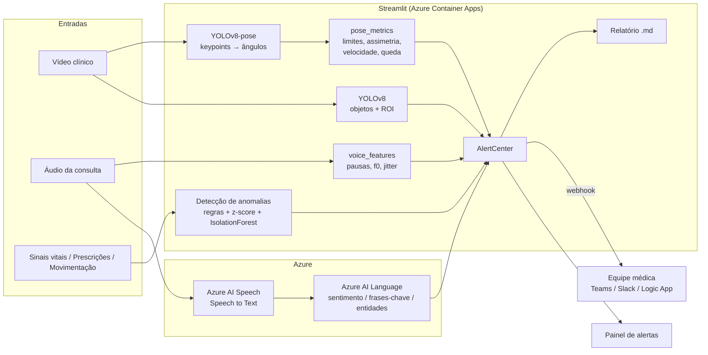
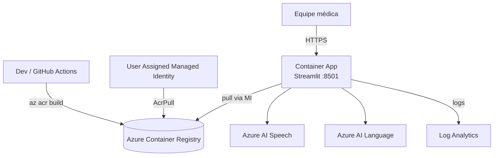

# Arquitetura

## Visão lógica

## Fluxo multimodal (fusão)

A fusão acontece **na camada de decisão** (*late fusion*): cada modalidade é analisada por seu
detector e produz `Alert(source, severity, title, message, when)`. A `AlertCenter` consolida todos
em um único modelo, ordena por severidade e entrega ao médico por três canais: painel,
relatório Markdown e webhook.

Por que *late fusion*: as modalidades têm taxas de amostragem e semânticas muito diferentes
(30 quadros/s, 16 mil amostras/s, 1 medição/min), os detectores são explicáveis individualmente e
cada alerta indica a evidência exata. Uma evolução natural é correlacionar alertas por janela de
tempo (ex.: queda de SpO2 + "falta de ar" na fala) para elevar a severidade.

## Infraestrutura Azure (IaC)

Arquivo único: [`infra/main.bicep`](../infra/main.bicep). Pontos de design:

* **Sem usuário admin no ACR**: o Container App puxa a imagem com *managed identity* + role `AcrPull`.
* **Segredos**: chaves de Speech/Language são lidas com `listKeys()` no próprio template e viram *secrets* do Container App (`secretRef`), sem passar por parâmetros nem pelo repositório.
* **Deploy em duas fases**: o ACR precisa existir antes do `az acr build`; a fase 1 sobe tudo com imagem placeholder, a fase 2 aponta para a imagem real. O mesmo template serve às duas (`containerImage` vazio ou não).
* **Streamlit usa websocket**: `stickySessions` mantém cada usuário na mesma réplica.
* **Escala**: 1–2 réplicas de 2 vCPU/4 GiB (YOLO em CPU). Para mais throughput, usar perfil de workload com GPU ou mover a inferência para um endpoint dedicado.

## Decisões técnicas

| Decisão | Motivo |
|---|---|
| **YOLOv8-pose no lugar do OpenPose** | Mesmos 17 keypoints COCO; instala com `pip`, roda em CPU/GPU, mesma biblioteca do YOLOv8 de objetos (um único runtime). OpenPose exige build C++/Caffe e modelos grandes, inviável numa imagem enxuta. A camada `pose_metrics` só consome keypoints, então trocar o extrator é localizado. |
| **Late fusion com `AlertCenter`** | Simples, explicável e extensível (ver acima). |
| **Detectores de séries explicáveis** | Em saúde, o clínico precisa saber *por que* disparou. Regras dão o limite; z-score robusto dá o desvio do próprio paciente; Isolation Forest cobre combinações multivariadas. Resultados são unidos por (timestamp, sinal) com a maior severidade e a razão de cada método. |
| **Episódios em vez de pontos** | Evita fadiga de alarmes: pontos consecutivos viram um alerta com início, fim e pico. |
| **Características vocais em NumPy** | Evita `librosa`/`numba` na imagem; f0 por autocorrelação via FFT é suficiente para indicadores grosseiros. |
| **Importação tardia de `ultralytics`, `cv2` e SDKs Azure** | Testes e CI rodam leves e rápidos; o app degrada com mensagem clara se faltar algo. |
| **Modo offline** | Permite desenvolver e demonstrar sem chaves Azure. |
| **`az acr build`** | Build na nuvem, sem Docker instalado na máquina do desenvolvedor. |

## Segurança e privacidade

* Segredos fora do código (`.env` ignorado no git; secrets do Container App no Azure).
* Imagem roda como usuário não-root.
* Uploads são gravados em arquivo temporário e removidos após o uso; nada é persistido.
* Dados de demonstração são sintéticos. Para dados reais seria necessário: LGPD (base legal, minimização, anonimização), rede privada (Private Endpoints), autenticação (Entra ID/Easy Auth) e trilha de auditoria.
